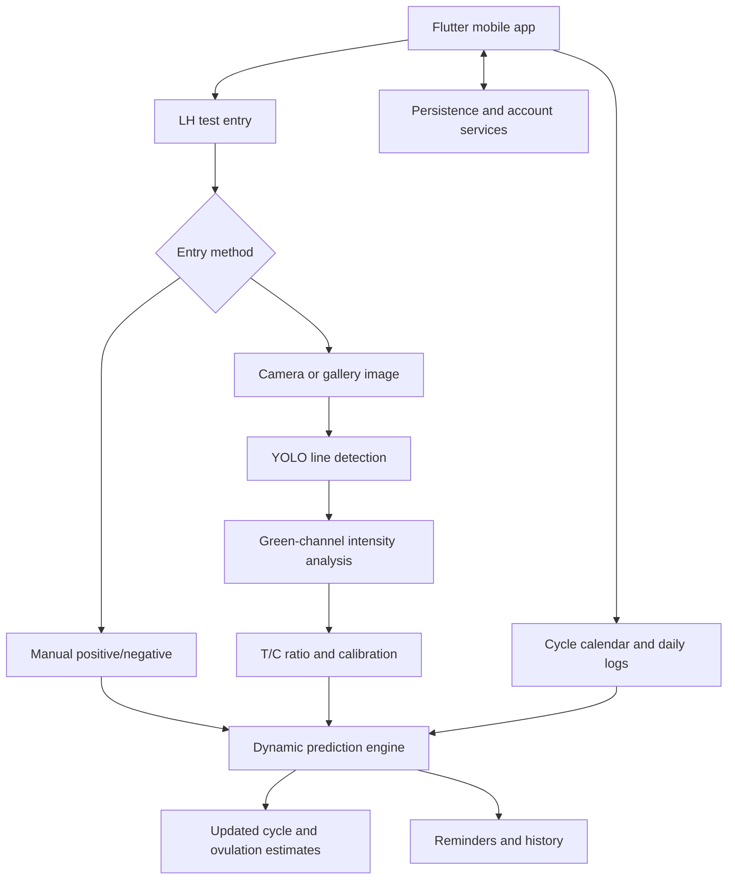

# HerCycle 🌸

**A personalized menstrual health and cycle-tracking app.**

HerCycle helps users record menstrual-cycle information and daily symptoms, view predicted cycle dates, and understand patterns over time. Its core direction is to move beyond a fixed calendar estimate: predictions can be refined using personal logs and, through LH-test tracking, home ovulation-test results.

> **Project status:** Prototype. The exact availability of individual features depends on the current app build. LH-strip computer vision, automated surge confirmation, and long-term self-tuning should be treated as in development until implemented and validated in the codebase.

## Table of Contents

- [Why HerCycle?](#why-hercycle)
- [Key Features](#key-features)
- [What Makes the Prediction Engine Different?](#what-makes-the-prediction-engine-different)
- [LH Test Analysis: Computer Vision Pipeline](#lh-test-analysis-computer-vision-pipeline)
- [System Architecture](#system-architecture)
- [Technology Stack](#technology-stack)
- [Data Model Overview](#data-model-overview)
- [Getting Started](#getting-started)
- [Typical User Workflow](#typical-user-workflow)
- [Privacy and Health Disclaimer](#privacy-and-health-disclaimer)
- [Current Limitations](#current-limitations)
- [Roadmap](#roadmap)
- [Contributing](#contributing)
- [License](#license)

## Why HerCycle?

A calendar-only tracker estimates future dates from an average cycle length. That can be useful as a starting point, but it cannot fully represent the variation in an individual's cycles.

HerCycle is designed around **personalized tracking**: it combines a baseline calendar estimate with daily user logs and, as the LH feature matures, ovulation-test observations. The goal is to revise estimates when meaningful personal evidence becomes available instead of relying indefinitely on a generic 28-day cycle.

## Key Features

- **Cycle tracking:** Record period dates and maintain a history of cycles.
- **Calendar-based estimates:** Estimate upcoming period and ovulation dates from the user's recorded cycle information.
- **Daily logs:** Record relevant symptoms and observations to build a personal history.
- **Personalized prediction design:** Use accumulated logs and confirmed events to refine future estimates over time.
- **LH test tracking — planned/in development:** Add tests manually as positive or negative, or submit a strip image for analysis.
- **LH history and status — planned/in development:** Review dated results, T/C ratios, and statuses such as *Low*, *Rising*, *High*, and *Peak*.
- **Smart testing prompts — planned/in development:** Use cervical-mucus observations to suggest when to begin daily LH testing.
- **Reminders and analytics — according to implementation:** The broader product plan includes cycle reminders, trend charts, and reports.

Features marked as planned/in development should not be interpreted as guarantees about the current release.

## What Makes the Prediction Engine Different?

The proposed prediction engine uses a tiered approach so that it can provide a baseline before enough personal data exists, then refine estimates as better evidence becomes available.

### Tier 1 — Baseline calendar estimate

At initial setup, the user supplies the last period start date and their typical cycle length. The initial defaults are a 28-day cycle and a 14-day luteal phase.

For a period start date `P` and estimated cycle length `L`:

- **Baseline next period:** `P + L days`
- **Baseline ovulation:** `P + (L - 14) days`

These are estimates, not confirmed biological events.

### Tier 2 — Cervical-mucus prompt

When the user logs a cervical-mucus score of 2, the planned experience prompts them to begin daily LH testing. The resulting tests can establish a personal pre-surge baseline.

### Tier 3 — LH surge detection and manual entries

The planned logic supports two input paths:

- **Manual positive:** Confirm a user-entered positive result, update the estimated ovulation date, and display an “ovulation expected in about 48 hours” message.
- **Manual negative:** Save the entry without overriding the existing calendar estimate.
- **Image-based result:** Analyze the strip and compare the latest calibrated T/C ratio with the user's baseline and a minimum threshold.

For automatic image-based confirmation, the engine uses two checks:

1. **Velocity gate:** The newest ratio must be at least `1.8 ×` the calculated baseline.
2. **Noise-floor gate:** The newest ratio must meet the configured minimum threshold, initially `0.45`.

A ratio below `0.45` is not treated as a confirmed surge under the initial rule; it is retained as a historical observation. Exact behavior should be tested against the final implementation and validated with representative strip images.

### Tier 4 — Personalization across cycles

After three completed cycles, the proposed engine replaces the initial fixed noise floor with an average derived from the user's confirmed peak thresholds. It also tracks the number of days between a confirmed LH surge and the start of the next period to estimate an individual rolling-average luteal phase length.

The purpose is to make future estimates more personal as data accumulates. This is a planned algorithm, not a claim that cycle or ovulation dates can be predicted with certainty.

## LH Test Analysis: Computer Vision Pipeline

The LH image-analysis workflow uses a YOLO model to locate the test and control lines, followed by image-intensity analysis and ratio calibration.

1. **Image input:** Capture a photo or select one from the gallery. The intended workflow does not require the user to crop the image manually.
2. **Detection:** Run the YOLO model with a confidence threshold of `0.15` and collect candidate bounding boxes.
3. **Deduplication:** Remove horizontally overlapping detections, retain the two highest-confidence distinct boxes, and sort them from left to right. The left box is treated as the test line (T) and the right box as the control line (C), assuming the supported strip layout follows that orientation.
4. **Background estimate:** Extract the green channel and calculate the 95th-percentile intensity from the region between the two line boxes, after applying the specified vertical safety margins.
5. **Line intensity:** Apply safety trims to each line box and use the 15th percentile of the green-channel pixels to estimate peak darkness. Calculate intensity as `max(0, background - peak darkness)`.
6. **Ratio:** Calculate the T/C ratio from the test and control line intensities, guarding against a zero control-line intensity.
7. **Calibration:** Apply piecewise-linear interpolation using these calibration anchor points:

   | Raw ratio | Calibrated ratio |
   |---:|---:|
   | 0.00 | 0.00 |
   | 0.16 | 0.13 |
   | 0.28 | 0.25 |
   | 0.58 | 0.51 |
   | 0.76 | 0.61 |
   | 0.80 | 0.86 |
   | 1.02 | 0.93 |
   | 2.00 | 2.20 |

8. **Result and calendar update:** Show the ratio and result status, save the observation, and pass it to the dynamic prediction logic.

### Model assets

- **Android:** `lh_single_strip_model.tflite` (quantized INT8)
- **iOS:** `lh_single_strip_model.mlpackage` (FP16 Core ML)

The image-processing pipeline is intended to run locally/off-device on the native client where supported. Model availability, platform integration, and numerical parity between implementations must be verified in the actual repository.

## System Architecture

The product direction separates the mobile experience, cycle/prediction logic, and LH image-analysis pipeline. The exact deployment architecture may differ between the current prototype and the target design.



### Proposed backend/data flow

The backend architecture can include a Python FastAPI service, persistent cycle and symptom data, image storage, notifications, and optional AI comfort-chat functionality. These services should be documented as deployed components only once their integration is present in the repository.

## Technology Stack

The following combines the mobile prototype context with the broader technical plan. Some libraries listed below are alternatives; confirm the selected packages against the actual codebase.

| Area | Technology | Role / status |
|---|---|---|
| Mobile app | Flutter, Dart | Android and iOS client |
| State management | Riverpod **or** Bloc | Choose the one actually used by the project |
| Charts | `fl_chart` **or** Syncfusion Charts | Analytics visualization; choice to be confirmed |
| Authentication and prototype persistence | Firebase Auth / Cloud Firestore | Existing prototype context; confirm current integrations |
| Backend API | Python, FastAPI | Proposed REST API layer |
| Data validation / ORM | Pydantic, SQLAlchemy | Proposed request validation and database access |
| Relational database | PostgreSQL | Planned structured storage for user, cycle, symptom, mood, partner, and LH data |
| Cache / chatbot memory | Redis | Proposed caching and chatbot-session support |
| Image storage | AWS S3 or Cloudinary | Proposed storage for uploaded test images, if needed |
| Computer vision | YOLOv8, OpenCV, NumPy, Pillow | LH-strip detection and intensity analysis |
| On-device model formats | TensorFlow Lite, Core ML | Proposed Android and iOS model deployment |
| AI comfort chatbot | OpenAI API or Azure OpenAI | Optional product-plan component; not required for cycle prediction |
| Analytics / reports | Pandas, Plotly, ReportLab | Proposed analysis, charts, and PDF reporting |
| Notifications | Firebase Cloud Messaging (FCM) | Proposed period, ovulation, medication, and hydration reminders |

## Data Model Overview

LH observations can be stored with fields such as:

```json
{
  "test_id": "<unique-id>",
  "timestamp": "<ISO-8601 timestamp>",
  "raw_ratio": 0.0,
  "calibrated_ratio": 0.0,
  "status": "Low",
  "image_url": null,
  "is_manual_entry": false
}
```

Cycle-level personalization metrics include:

- `actual_luteal_phase`
- `personal_peak_threshold`
- `historical_noise_floor`

This is an illustrative schema, not a production database migration. The implementation should also define units, nullable fields, ownership/access rules, retention policy, and validation constraints.

## Getting Started

### Requirements

For the Flutter prototype, install and configure:

- Flutter SDK and Dart SDK compatible with the project.
- Android Studio or Xcode, depending on the target platform.
- Git.
- Firebase project configuration if the current app build depends on Firebase.

For backend and computer-vision components, the development environment may additionally require Python, the project's Python dependencies, database credentials, storage configuration, and platform-specific model assets.

### Run the mobile app

1. Clone the repository:

   ```bash
   git clone <repository-url>
   cd <repository-directory>
   ```

2. Install the Flutter dependencies:

   ```bash
   flutter pub get
   ```

3. Configure the Firebase project files and environment values required by this repository. **Do not commit service-account credentials, API keys, or other secrets.**

4. Check available devices and run the app:

   ```bash
   flutter devices
   flutter run
   ```

These are the standard Flutter steps; actual configuration commands may differ depending on the repository's directory structure and current integrations.

### Run the backend (if present in the repository)

If the repository includes a FastAPI backend, use its actual folder structure and entry-point filename. After installing the backend dependencies and configuring environment variables, run the ASGI application using the import path defined in your codebase, for example:

```bash
python -m venv .venv
# Windows PowerShell:
.venv\Scripts\Activate.ps1
# macOS/Linux:
source .venv/bin/activate
pip install -r <path-to-backend-requirements.txt>
uvicorn <module>:app --reload
```

Replace the placeholders with the actual requirements-file path and FastAPI module path in the repository. Configure PostgreSQL, Redis, image storage, and authentication only if those services are implemented and required by the current build.

## Typical User Workflow

1. Enter the last period start date and typical cycle length.
2. Review baseline period and ovulation estimates in the calendar.
3. Record daily symptoms and relevant observations.
4. When the LH feature is available, log a test manually or submit a strip image.
5. Review the result and historical trend. Image-based results should be validated by the user and should not be treated as a medical diagnosis.
6. As confirmed data accumulates, the prediction engine can use personal thresholds and luteal-phase history to refine future estimates.

## Privacy and Health Disclaimer

HerCycle handles sensitive reproductive-health information. A production deployment should use appropriate authentication, least-privilege database access, secure transport, protected image storage, and clear retention/deletion controls. Never place private keys or production credentials in the repository. Any uploaded LH-strip images should be stored only with explicit user-facing disclosure and suitable access controls.

HerCycle is intended for tracking and informational support. **Cycle and ovulation estimates can be wrong and are not a substitute for advice from a qualified healthcare professional.** LH strip interpretation may be affected by image quality, lighting, strip brand, test instructions, and individual circumstances. The app should not be presented as a contraceptive method or a diagnostic tool.

## Current Limitations

- The project is a prototype; not every part of the target architecture may be implemented or production-ready.
- Baseline calendar formulas rely on averages and cannot account for every source of cycle variation.
- Image-based LH analysis depends on model quality, strip orientation, lighting, line localization, and calibration.
- The YOLO detection threshold and ratio calibration anchors require testing on representative data across supported strip brands and image conditions.
- The planned personalization rules need real-world validation before their outputs are described as clinically reliable.
- Android TensorFlow Lite and iOS Core ML results must be checked for consistency with the reference Python/OpenCV implementation.

## Roadmap

- [ ] Complete and validate cycle tracking and daily-log flows.
- [ ] Add LH test history with manual positive/negative entries.
- [ ] Integrate YOLO-based test/control line detection for camera and gallery images.
- [ ] Match client-side percentile calculations and ratio calibration with the reference Python pipeline.
- [ ] Implement hybrid surge confirmation using the baseline-relative velocity gate and minimum threshold.
- [ ] Recalculate estimates using confirmed surges and personalized luteal-phase history.
- [ ] Add gated developer diagnostics for image detections and ratio calculations.
- [ ] Validate model behavior across supported devices, lighting conditions, and strip types.
- [ ] Finalize backend, database, storage, authentication, and notification architecture.
- [ ] Add privacy controls, data export/deletion, automated tests, and release documentation.

## Contributing

Contributions, bug reports, and feedback are welcome. Before opening a pull request:

1. Describe the behavior being changed and why.
2. Include relevant steps to reproduce or test the change.
3. Avoid including real users' menstrual, symptom, or LH-test data in issues, screenshots, fixtures, or commits.
4. For prediction or computer-vision changes, document the formula or calibration change and add tests using synthetic or properly consented, de-identified sample data.

## License

No license has been specified yet. Add a `LICENSE` file and update this section before distributing the project publicly. Until then, do not assume that the repository is open-source licensed.
